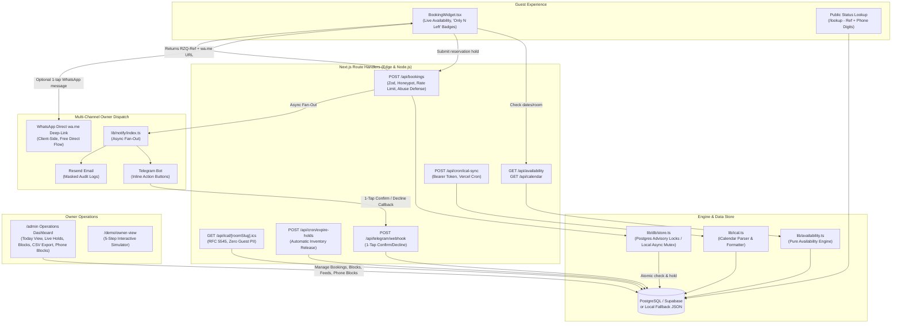

# Rizq Luxurious Villa — Direct Booking Engine & Operations Platform

Production-grade direct booking engine, availability engine, owner operations dashboard, and guest web platform for **Rizq Luxurious Villa**, an architectural luxury villa-hostel in Dubai situated on the Al Quoz / Business Bay border (near Downtown Dubai and Burj Khalifa). This platform runs on free tiers.

Engineered specifically for digital nomads, developers, and premium travelers with capsule pods, private suites, 500 Mbps Wi-Fi, coworking space, social lounge, and an outdoor swimming pool.

---

## Direct Booking Architecture

The booking engine is designed around a **runs on free tiers, privacy-first** paradigm. In local demo mode, the application runs 100% offline with zero environment variables, utilizing an in-memory/JSON store with async Mutex concurrency control. In production, it connects to Supabase (PostgreSQL with advisory row locking), Resend (free tier), and Telegram Bot API (free).



---

## What Is Real Today vs. Roadmap

### Real & Implemented Today
- **Runs on Free Tiers Direct Engine**: Operates out of the box with zero third-party subscriptions or monthly fees.
- **Race-Safe Inventory Control**: Prevents double-bookings under peak concurrent traffic using PostgreSQL RPC advisory locks (`pg_advisory_xact_lock`) or serialized in-memory async mutex queue in local store mode.
- **Pure Availability Engine (`/lib/availability.ts`)**: Accurately computes night-by-night occupancy (excluding check-out day), hold expirations, manual/OTA blocks, minimum stays, and smart alternative suggestions (alternative dates or rooms when sold out).
- **Abuse Protection & Rate Limiting**:
  - Max 2 active pending holds per phone number (normalized across formatting variations) and per IP.
  - Booking creation rate limit: 3 requests per 10 minutes per IP with hidden honeypot defense.
  - Status lookup rate limit: 5 attempts per 15 minutes per IP and per ref, returning identical error responses for invalid references and mismatched phone digits to prevent enumeration.
  - Admin phone blocking action with instant rejection at booking submission.
- **Owner Notification Fan-Out**: Multi-channel alerts via Telegram Bot with 1-tap callback buttons (`Confirm`, `Decline`), HTML email via Resend, and client-side prefilled WhatsApp links (`wa.me`) without Twilio/WhatsApp Business API fees. Halfway reminders (at 6 hours) sent if holds remain pending.
- **iCalendar Sync Engine (`/lib/ical.ts`)**:
  - Outbound: RFC 5545 `.ics` feed per room type publishing confirmed bookings and manual blocks with zero guest PII (summary is always sanitized to `"Booked"`).
  - Inbound: Background sync cron endpoint (`/api/cron/ical-sync`) to import external calendars into non-overlapping blocks, plus manual "Sync All Feeds" admin control.
- **Operations Dashboard (`/admin`)**: Single password cookie-authenticated command center featuring Today's arrivals/departures, live countdowns on pending holds, calendar date blocks tool, iCal feed manager, phone number block tool, and CSV export.
- **Interactive Simulator (`/demo/owner-view`)**: 5-step interactive walkthrough demonstrating guest submission, owner notification, instant 1-tap confirmation, and calendar block synchronization.
- **Public Reservation Lookup (`/lookup`)**: Allows guests to check booking status (`Awaiting confirmation`, `Confirmed`, `Not available`, `Expired`) using their unique reference (`RZQ-XXXXXX`) verified by the last 4 digits of their phone number, exposing zero personal contact info.

### Honest Roadmap (Future Enhancements)
- **Stripe / Credit Card Guarantee**: Optional pre-authorization or deposit collection if the owner desires upfront card holds instead of WhatsApp payment arrangement.
- **Direct 2-Way PMS API**: Direct API connectors (e.g. Cloudbeds or Mews) should the property scale beyond iCal feeds.
- **Automated SMS Reminders**: Twilio SMS fallback for travelers without active mobile data upon landing at DXB.

> **Honesty Notice:** The public guest-facing pages never claim instant real-time sync with third-party OTAs, nor do they mention third-party platform names (Agoda, Hostelworld, Trip.com, Booking.com). Calendar sync relies on standard RFC 5545 iCalendar polling schedules.

---

## Tech Stack & Design Tokens

- **Framework**: Next.js 14+ (App Router, Server & Client Components)
- **Language**: TypeScript Strict (`noImplicitAny`, strict null checks)
- **Styling**: Tailwind CSS with "Urban Slate" Warm Luxury Palette:
  - Source Palette: `#E9E6E7` (soft pearl), `#5E5653` (warm umber), `#7B7F8A` (cool slate grey), `#AB978C` (warm taupe), `#6B7C98` (slate blue)
  - Derived Shades: `umber-950` (`#1C1816`), `umber-900` (`#262120`), `umber-800` (`#352E2C`), `pearl-50` (`#F6F4F5`), `slate-blue-700` (`#4F5E78`), `accent-strong` (`#96806F`), `success` (`#3E7B52`)
- **Validation**: Zod schema validation on all inputs and API payloads
- **Testing**: Vitest unit, concurrency, and integration test suites

---

## Quick Start & Local Demo Mode

The application is configured to run out-of-the-box in **Zero-Config Local Demo Mode** without needing any database or third-party API keys.

### 1. Installation
```bash
npm install
```

### 2. Run Local Development Server
```bash
npm run dev
```
Open [http://localhost:3000](http://localhost:3000) to view the villa website.
- **Guest Booking Portal**: [http://localhost:3000/book](http://localhost:3000/book)
- **Owner Demo Walkthrough**: [http://localhost:3000/demo/owner-view](http://localhost:3000/demo/owner-view)
- **Operations Dashboard**: [http://localhost:3000/admin](http://localhost:3000/admin) (Default password: `demo_admin_2026`)
- **Public Lookup**: [http://localhost:3000/lookup](http://localhost:3000/lookup)

### 3. Seed Demo Data / Clear Demo Data
To populate sample bookings, blocks, and feeds for testing the dashboard:
```bash
npm run seed
```
To purge all demo records and return to a pristine state:
```bash
npm run seed:clear
```

### 4. Running the Test Suite
```bash
npm test
```

---

## Production Setup & Integration Guides

To activate live database persistence and multi-channel notifications in production, configure the following free-tier services:

### 1. Supabase (PostgreSQL Database)
1. Create a free PostgreSQL database at [supabase.com](https://supabase.com).
2. Go to the **SQL Editor** in your Supabase project dashboard.
3. Open [`supabase/migrations/20261016_booking_backend.sql`](supabase/migrations/20261016_booking_backend.sql) and run the script.
   - Creates `room_types`, `bookings`, `blocks`, `ical_feeds`, and `audit_log` tables.
   - Configures Row Level Security (RLS) policies.
   - Deploys the atomic `create_booking_request` RPC with transaction-level advisory locks.
4. Copy your **Project URL** and **Service Role API Key** from Project Settings > API.
5. In your production environment (e.g. Vercel / Railway), set:
   ```env
   ENABLE_BACKEND=true
   NEXT_PUBLIC_SUPABASE_URL=https://your-project.supabase.co
   SUPABASE_SERVICE_ROLE_KEY=eyJh...
   ```

### 2. Telegram Bot (Free Owner Alerts & 1-Tap Approvals)
1. Open Telegram and search for `@BotFather`.
2. Send `/newbot`, name your bot (e.g., `RizqVillaBookingBot`), and save the HTTP API Token.
3. Get your Telegram Chat ID:
   - Message `@userinfobot` or your newly created bot, then visit:
     `https://api.telegram.org/bot<YOUR_BOT_TOKEN>/getUpdates` to find `"id"`.
4. In your `.env.local` or host dashboard, set:
   ```env
   TELEGRAM_BOT_TOKEN=123456789:ABCdefGHIjklMNOpqrsTUVwxyz
   TELEGRAM_OWNER_CHAT_ID=123456789
   TELEGRAM_WEBHOOK_SECRET=your_random_32_char_secret_string
   ```
5. Register the webhook with Telegram:
   ```bash
   npm run telegram:set-webhook
   ```

### 3. Resend (Email Notifications)
1. Sign up for a free account at [resend.com](https://resend.com) (3,000 free emails/month).
2. Create an API key and verify your domain (or use test email during staging).
3. Set in environment variables:
   ```env
   RESEND_API_KEY=re_123456789
   OWNER_NOTIFICATION_EMAIL=reservations@yourdomain.com
   EMAIL_FROM=bookings@yourdomain.com
   ```

### 4. Vercel Cron Schedules & Plan Limits
Automated calendar synchronization and hold expiration are pre-configured in [`vercel.json`](vercel.json):
```json
{
  "crons": [
    {
      "path": "/api/cron/ical-sync",
      "schedule": "*/30 * * * *"
    },
    {
      "path": "/api/cron/expire-holds",
      "schedule": "0 * * * *"
    }
  ]
}
```
**Important note on Vercel plan limits:**
- **Vercel Hobby Tier**: Supports daily cron executions (e.g. `0 0 * * *`). Sub-hourly schedules require a Pro plan.
- **Graceful Hybrid Fallback**: To ensure correct availability on free Hobby accounts, the application performs lazy expiration of stale holds on every `/lookup` and `/admin` request, and the Operations Dashboard includes a manual **Sync All Feeds** button.

---

## Complete API Route Reference

| Method | Endpoint | Description | Security / Rate Limit |
|---|---|---|---|
| `GET` | `/api/availability` | Checks live availability for dates and room type; returns alternative dates/rooms on sold-out | Public, cached |
| `GET` | `/api/calendar` | Returns month grid with day occupancy states (`available`, `few_left`, `sold_out`) | Public |
| `POST` | `/api/bookings` | Submits booking request, takes 12-hour hold, returns `RZQ-` ref and `wa.me` URL | 3 req/10 min/IP, honeypot, Zod, max 2 active holds |
| `GET` | `/api/bookings/[ref]` | Guest status lookup by ref; requires last 4 digits of phone number | 5 attempts/15 min per IP & ref, identical anti-enumeration error |
| `GET` | `/api/ical/[roomSlug].ics` | Outbound RFC 5545 iCalendar feed publishing confirmed bookings & blocks | Private `?token=` parameter |
| `POST` | `/api/cron/ical-sync` | Imports external feeds and converts entries into room blocks | Bearer `CRON_SECRET` |
| `POST` | `/api/cron/expire-holds` | Scans for holds past `hold_expires_at`, marks `expired`, frees inventory | Bearer `CRON_SECRET` |
| `POST` | `/api/telegram/webhook` | Handles Telegram inline callback buttons (`confirm_...`, `decline_...`) | `X-Telegram-Bot-Api-Secret-Token` |
| `GET` | `/api/admin/bookings` | Lists and filters all bookings by status, date, or search query | Admin session cookie |
| `POST` | `/api/admin/bookings/[id]/confirm` | Confirms a booking manually from dashboard | Admin session cookie |
| `POST` | `/api/admin/bookings/[id]/decline` | Declines a booking with documented reason | Admin session cookie |
| `POST` | `/api/admin/bookings/[id]/cancel` | Cancels a booking and releases dates | Admin session cookie |
| `GET` | `/api/admin/phone-blocks` | Lists all blocked phone numbers | Admin session cookie |
| `POST` | `/api/admin/phone-blocks` | Adds a phone number to the blocked list | Admin session cookie |
| `DELETE` | `/api/admin/phone-blocks/[phone]` | Removes a phone number from the blocked list | Admin session cookie |
| `POST` | `/api/admin/blocks` | Creates manual room blocks (maintenance, private events) | Admin session cookie |
| `DELETE` | `/api/admin/blocks/[id]` | Removes a manual block | Admin session cookie |
| `GET` | `/api/admin/ical-feeds` | Lists configured external calendar feeds | Admin session cookie |
| `POST` | `/api/admin/ical-feeds` | Adds an external iCal URL | Admin session cookie |
| `POST` | `/api/admin/ical-feeds/[id]/sync` | Triggers immediate manual sync for a specific feed | Admin session cookie |
| `GET` | `/api/admin/export` | Exports all bookings to CSV format | Admin session cookie |
| `GET` | `/api/admin/settings` | Views system policies and unverified client parameters | Admin session cookie |

---

## Security & Privacy Safeguards

1. **Zero PII Exposure in iCal Feeds**: Outbound `.ics` feeds strictly contain `SUMMARY:Booked` and omit guest names, phone numbers, emails, and financial amounts.
2. **Timing-Safe Admin Authentication**: Admin login utilizes Node.js `crypto.timingSafeEqual` with HMAC-signed session cookies to resist timing attacks.
3. **Anti-Enumeration Lookup Protection**: The lookup endpoint `/api/bookings/[ref]` enforces a 5-attempt rate limit per 15 minutes and returns the exact same generic error message for invalid references and mismatched phone numbers.
4. **Data Retention & Privacy Notice**: Guest records are retained for a configurable period (default 90 days) after departure and can be purged upon request.
5. **Honeypot & Abuse Prevention**: Booking submissions feature honeypot trapping, strict rate limiting (3 requests per 10 minutes per IP), a limit of 2 active holds per normalized phone number and IP, and admin phone blocking capabilities.
6. **Masked Audit Logging**: Contact details in audit logs are masked for privacy.

---

## License & Ownership

Developed for **Rizq Luxurious Villa, Dubai**. All rights reserved.
